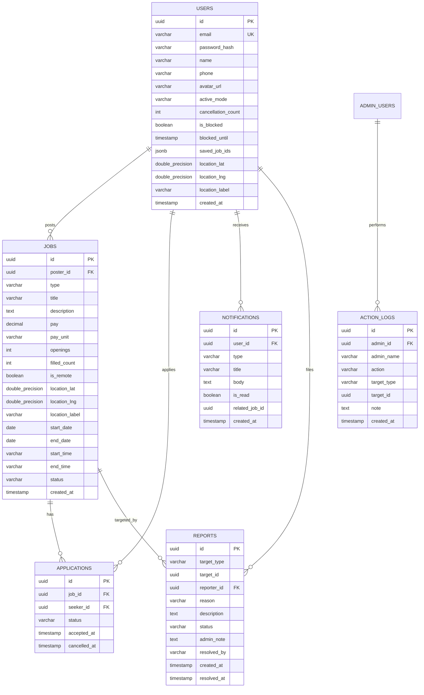

# JobHunt — Backend Handoff Package
> **Target Stack:** Spring Boot (Java 17/21) + PostgreSQL 15/16 + Spring Security + Spring Data JPA  
> **Audience:** Backend Engineer building the REST API to replace the frontend mock layer with **zero frontend code changes**.  
> **Frontend Codebase:** `mobile/` (React Native / Expo SDK 57) + `admin/` (React 19 / Vite / Tailwind)

---

## 1. Stack Summary

### 1.1 Frontend Architectural Overview

| Application | Framework / Runtime | Language | State Management | Primary Libraries |
|-------------|---------------------|----------|------------------|-------------------|
| **Mobile App (`mobile/`)** | React Native 0.86.3, Expo SDK 57, Expo Router 57 | TypeScript 5.3+ | Zustand 5.0 (`authStore`, `jobStore`) | `@expo/vector-icons/Ionicons`, `expo-secure-store`, `expo-location`, `react-native-maps`, `date-fns` |
| **Admin Panel (`admin/`)** | React 19, Vite 6 | TypeScript 5.3+ | Zustand 5.0 (`adminAuthStore`) | `lucide-react`, `tailwindcss`, `react-router-dom` v7 |

### 1.2 Configuration Files & Mock Switching

#### Mobile Application (`mobile/`):
- **Mock Flag & Service Switcher:** [`mobile/src/services/index.ts`](file:///c:/Users/Shiva%20Singh/OneDrive/Desktop/Job_Hunt/mobile/src/services/index.ts)
  ```typescript
  const USE_MOCK = process.env.EXPO_PUBLIC_USE_MOCK !== 'false';
  ```
- **Base URL Environment Variable:** `EXPO_PUBLIC_API_BASE_URL` in `mobile/.env` (e.g., `http://10.162.68.159:8080/api/v1` for real phones, `http://10.0.2.2:8080/api/v1` for Android emulator).
- **How to Switch to Real API:**
  1. Create `mobile/.env` containing:
     ```bash
     EXPO_PUBLIC_USE_MOCK=false
     EXPO_PUBLIC_API_BASE_URL=http://10.162.68.159:8080/api/v1
     ```
  2. Implement `realService.ts` implementing the TypeScript interfaces in [`mobile/src/services/types.ts`](file:///c:/Users/Shiva%20Singh/OneDrive/Desktop/Job_Hunt/mobile/src/services/types.ts) (`IAuthService`, `IJobService`, `IUserService`, `INotificationService`, `IReportService`).
  3. Export real services in `mobile/src/services/index.ts`.

#### Admin Web Panel (`admin/`):
- **Base URL & Mock Configuration:** Configured in `admin/.env`:
  ```bash
  VITE_USE_MOCK=false
  VITE_API_BASE_URL=http://localhost:8080/api/v1/admin
  ```
- **Service Layer:** [`admin/src/services/adminService.ts`](file:///c:/Users/Shiva%20Singh/OneDrive/Desktop/Job_Hunt/admin/src/services/adminService.ts) and [`admin/src/store/adminAuthStore.ts`](file:///c:/Users/Shiva%20Singh/OneDrive/Desktop/Job_Hunt/admin/src/store/adminAuthStore.ts).

---

## 2. API Contract (Final & Complete)

All requests to protected endpoints require:
```http
Authorization: Bearer <accessToken>
Content-Type: application/json
```

All responses follow the consistent JSON envelope:
```json
{
  "success": true,
  "data": { ... },
  "error": null
}
```
Or on error:
```json
{
  "success": false,
  "data": null,
  "error": {
    "code": "ERROR_CODE_STRING",
    "message": "Human readable description",
    "pendingItems": []
  }
}
```

---

### 2.1 Authentication Endpoints (Mobile)

#### `POST /api/v1/auth/register`
- **Auth Required:** No
- **Headers:** `Content-Type: application/json`
- **Request Body:**
  ```json
  {
    "name": "Alex Johnson",
    "email": "alex@college.edu",
    "password": "password123",
    "phone": "+91 98765 43210"
  }
  ```
  *(Note: `phone` is optional string or null. `email` is lowercase).*
- **Success Response (`201 Created`):**
  ```json
  {
    "success": true,
    "data": {
      "user": {
        "id": "usr_01HXYZ123",
        "name": "Alex Johnson",
        "email": "alex@college.edu",
        "phone": "+91 98765 43210",
        "avatarUrl": null,
        "activeMode": "SEEKER",
        "cancellationCount": 0,
        "isBlocked": false,
        "blockedUntil": null,
        "savedJobIds": [],
        "location": null,
        "createdAt": "2026-10-18T10:00:00.000Z"
      },
      "accessToken": "eyJhbGciOi...",
      "refreshToken": "def50200..."
    },
    "error": null
  }
  ```
- **Error Responses:**
  - `409 Conflict`:
    ```json
    { "success": false, "data": null, "error": { "code": "CONFLICT", "message": "Email already registered." } }
    ```
  - `422 Unprocessable Entity`:
    ```json
    { "success": false, "data": null, "error": { "code": "VALIDATION_ERROR", "message": "Minimum 8 characters required for password." } }
    ```

#### `POST /api/v1/auth/login`
- **Auth Required:** No
- **Request Body:**
  ```json
  {
    "email": "alex@college.edu",
    "password": "password123"
  }
  ```
- **Success Response (`200 OK`):** Same shape as Register response.
- **Error Responses:**
  - `404 Not Found`:
    ```json
    { "success": false, "data": null, "error": { "code": "NOT_FOUND", "message": "No account with that email." } }
    ```
  - `401 Unauthorized`:
    ```json
    { "success": false, "data": null, "error": { "code": "UNAUTHORIZED", "message": "Incorrect password." } }
    ```
  - `403 Forbidden`:
    ```json
    { "success": false, "data": null, "error": { "code": "USER_BLOCKED", "message": "Account suspended for 24 hours due to 3 cancellations." } }
    ```

#### `POST /api/v1/auth/refresh`
- **Auth Required:** No
- **Request Body:**
  ```json
  {
    "refreshToken": "def50200..."
  }
  ```
- **Success Response (`200 OK`):**
  ```json
  {
    "success": true,
    "data": {
      "accessToken": "eyJhbGciOi_new...",
      "refreshToken": "def50200_new..."
    },
    "error": null
  }
  ```
- **Error Response (`401 Unauthorized`):**
  ```json
  { "success": false, "data": null, "error": { "code": "UNAUTHORIZED", "message": "Refresh token expired or invalid." } }
  ```

#### `POST /api/v1/auth/logout`
- **Auth Required:** Yes (`Bearer <accessToken>`)
- **Request Body:**
  ```json
  {
    "refreshToken": "def50200..."
  }
  ```
- **Success Response (`200 OK`):**
  ```json
  { "success": true, "data": { "message": "Logged out successfully." }, "error": null }
  ```

#### `POST /api/v1/auth/forgot-password`
- **Auth Required:** No
- **Request Body:**
  ```json
  {
    "email": "alex@college.edu"
  }
  ```
- **Success Response (`200 OK`):**
  ```json
  { "success": true, "data": { "message": "Password reset link sent if registered." }, "error": null }
  ```

---

### 2.2 User Profile & Mode Endpoints

#### `GET /api/v1/users/me`
- **Auth Required:** Yes (`Bearer <accessToken>`)
- **Success Response (`200 OK`):**
  ```json
  {
    "success": true,
    "data": {
      "id": "usr_01HXYZ123",
      "name": "Alex Johnson",
      "email": "alex@college.edu",
      "phone": "+91 98765 43210",
      "avatarUrl": null,
      "activeMode": "SEEKER",
      "cancellationCount": 0,
      "isBlocked": false,
      "blockedUntil": null,
      "savedJobIds": ["job_03"],
      "location": {
        "lat": 28.6139,
        "lng": 77.2090,
        "label": "Delhi University Campus"
      },
      "createdAt": "2026-09-18T10:00:00.000Z"
    },
    "error": null
  }
  ```

#### `PATCH /api/v1/users/me`
- **Auth Required:** Yes
- **Request Body (Partial fields allowed):**
  ```json
  {
    "name": "Alex Johnson",
    "phone": "+91 98765 43210",
    "avatarUrl": "https://cdn.jobhunt.campus/avatars/user-1.jpg"
  }
  ```
- **Success Response (`200 OK`):** Returns updated User object.

#### `PATCH /api/v1/users/me/location`
- **Auth Required:** Yes
- **Request Body:**
  ```json
  {
    "lat": 28.6890,
    "lng": 77.2098,
    "label": "Delhi University, North Campus"
  }
  ```
- **Success Response (`200 OK`):**
  ```json
  {
    "success": true,
    "data": {
      "location": {
        "lat": 28.6890,
        "lng": 77.2098,
        "label": "Delhi University, North Campus"
      }
    },
    "error": null
  }
  ```

#### `POST /api/v1/users/me/switch-mode`
- **Auth Required:** Yes
- **Request Body:**
  ```json
  {
    "mode": "RECRUITER"
  }
  ```
  *(Allowed values: `"SEEKER" | "RECRUITER"`)*
- **Success Response (`200 OK`):**
  ```json
  {
    "success": true,
    "data": {
      "activeMode": "RECRUITER"
    },
    "error": null
  }
  ```
- **Mode Lock Error Response (When strict lock is enabled):**
  If switching from SEEKER to RECRUITER with pending accepted gigs:
  ```json
  {
    "success": false,
    "data": null,
    "error": {
      "code": "MODE_LOCK_SEEKER",
      "message": "You have active accepted gigs. Please complete or cancel them before switching to Recruiter mode.",
      "pendingItems": [
        { "id": "app-1", "title": "Event Setup Helper", "status": "ACCEPTED" }
      ]
    }
  }
  ```
  If switching from RECRUITER to SEEKER with open posts:
  ```json
  {
    "success": false,
    "data": null,
    "error": {
      "code": "MODE_LOCK_RECRUITER",
      "message": "You have active open gig posts. Please close or cancel them before switching to Seeker mode.",
      "pendingItems": [
        { "id": "job-2", "title": "Food Stall Assistant", "status": "OPEN" }
      ]
    }
  }
  ```

---

### 2.3 Jobs & Marketplace Endpoints

#### `GET /api/v1/jobs` (Seeker Search & Feed)
- **Auth Required:** Yes
- **Query Parameters:**
  | Parameter | Type | Required | Description |
  |-----------|------|----------|-------------|
  | `lat` | Double | Yes | Seeker's current GPS latitude |
  | `lng` | Double | Yes | Seeker's current GPS longitude |
  | `type` | String | No | `'SHORT_TERM'` or `'LONG_TERM'` |
  | `keyword` | String | No | Search string matching title/description |
  | `minPay` | Number | No | Minimum compensation in INR (₹) |
  | `maxPay` | Number | No | Maximum compensation in INR (₹) |
  | `page` | Integer| No | Page number (1-indexed, default: 1) |
  | `limit`| Integer| No | Items per page (default: 20) |
- **Filter Rules Enforced by Server:**
  1. Only jobs with `status = 'OPEN'` and `postedBy.id != currentUser.id`.
  2. On-site jobs (`isRemote = false`): Distance from `(lat, lng)` must be **≤ 5.0 km**.
  3. Remote jobs (`isRemote = true`): Visible regardless of distance (`approximateDistance = null`).
  4. `location.label`: Returned as `"HIDDEN"` for on-site jobs if not yet accepted by current user.
- **Success Response (`200 OK`):**
  ```json
  {
    "success": true,
    "data": {
      "jobs": [
        {
          "id": "job-1",
          "type": "SHORT_TERM",
          "title": "Event Setup Helper",
          "description": "Help set up tables, chairs, and stage audio for college fest.",
          "pay": 300,
          "payUnit": "FIXED",
          "openings": 3,
          "filledCount": 1,
          "isRemote": false,
          "approximateDistance": 0.4,
          "location": {
            "lat": 28.6145,
            "lng": 77.2085,
            "label": "HIDDEN"
          },
          "startDate": "2026-10-25",
          "endDate": "2026-10-25",
          "startTime": "09:00",
          "endTime": "12:00",
          "status": "OPEN",
          "postedBy": {
            "id": "usr_02",
            "name": "Priya Sharma",
            "avatarUrl": null
          },
          "isSaved": false,
          "createdAt": "2026-10-17T08:30:00.000Z"
        }
      ],
      "total": 1,
      "page": 1,
      "totalPages": 1
    },
    "error": null
  }
  ```

#### `GET /api/v1/jobs/{id}`
- **Auth Required:** Yes
- **Success Response (`200 OK`):**
  Returns the single `Job` object.
  - **Address Privacy:** If the requesting user has an `ACCEPTED` application for this job, `location.label` reveals the exact building & room (e.g., `"North Campus, Block C, Room 201"`). Otherwise, returns `"HIDDEN"`.
- **Error Response (`404 Not Found`):**
  ```json
  { "success": false, "data": null, "error": { "code": "NOT_FOUND", "message": "Job not found." } }
  ```

#### `POST /api/v1/jobs` (Create Gig Posting)
- **Auth Required:** Yes (Role/Mode check: `activeMode === 'RECRUITER'`)
- **Request Body:**
  ```json
  {
    "type": "SHORT_TERM",
    "title": "Science Lab Assistant",
    "description": "Assist with organizing lab glassware and labeling test tubes.",
    "pay": 400,
    "payUnit": "FIXED",
    "openings": 2,
    "isRemote": false,
    "location": {
      "lat": 28.6145,
      "lng": 77.2085,
      "label": "Science Block, Chemistry Lab 3"
    },
    "startDate": "2026-10-26",
    "endDate": "2026-10-26",
    "startTime": "10:00",
    "endTime": "13:00"
  }
  ```
- **Validation Rules:**
  - If user `isBlocked = true` -> Error `USER_BLOCKED`.
  - If user `activeMode != 'RECRUITER'` -> Error `FORBIDDEN`.
  - `SHORT_TERM`: duration must be `> 0` and `≤ 300 minutes` (5 hours). Always `isRemote: false`.
  - `LONG_TERM`: `startDate < endDate`.
- **Success Response (`201 Created`):** Returns the created `Job` object.
- **Error Responses:**
  - `403 Forbidden`: `{ "error": { "code": "FORBIDDEN", "message": "Switch to Recruiter mode first." } }`
  - `403 Forbidden`: `{ "error": { "code": "USER_BLOCKED", "message": "Your account is blocked." } }`
  - `422 Unprocessable Entity`: `{ "error": { "code": "VALIDATION_ERROR", "message": "Short-term gigs cannot exceed 5 hours in duration." } }`

#### `DELETE /api/v1/jobs/{id}` (Recruiter Cancels Post)
- **Auth Required:** Yes (Must be the creator `postedBy.id === currentUser.id`)
- **Success Response (`200 OK`):**
  ```json
  { "success": true, "data": { "message": "Job cancelled." }, "error": null }
  ```
- **Side Effects:**
  - Job status becomes `'CANCELLED'`.
  - If `filledCount > 0`, recruiter cancellation strikes increment by 1, and accepted seekers receive notification of type `'RECRUITER_CANCELLED'`.
  - If `filledCount == 0`, no strike penalty is incurred.

#### `POST /api/v1/jobs/{id}/accept` (Seeker Accepts Gig)
- **Auth Required:** Yes (Must be in `SEEKER` mode)
- **Concurrency & Race Condition Rule:** High-speed direct acceptance. Use PostgreSQL row lock (`PESSIMISTIC_WRITE` / `SELECT ... FOR UPDATE`) on the job row.
- **Success Response (`200 OK`):**
  ```json
  {
    "success": true,
    "data": {
      "applicationId": "app_01JABC999",
      "status": "ACCEPTED",
      "job": {
        "id": "job-1",
        "title": "Event Setup Helper",
        "location": {
          "lat": 28.6145,
          "lng": 77.2085,
          "label": "Main Campus Gate, North Block, Room 101"
        },
        "status": "FILLED"
      }
    },
    "error": null
  }
  ```
- **Error Responses:**
  - `403 Forbidden`: `{ "error": { "code": "USER_BLOCKED", "message": "Your account is blocked." } }`
  - `403 Forbidden`: `{ "error": { "code": "FORBIDDEN", "message": "Switch to Seeker mode first." } }`
  - `400 Bad Request`: `{ "error": { "code": "OWN_JOB", "message": "You cannot accept your own job." } }`
  - `409 Conflict`: `{ "error": { "code": "ALREADY_TAKEN", "message": "This job was just filled. Try another one." } }`
  - `409 Conflict`: `{ "error": { "code": "TIME_CONFLICT", "message": "You already have an overlapping job at that time." } }`

#### `POST /api/v1/jobs/{id}/cancel-acceptance` (Seeker Withdraws)
- **Auth Required:** Yes
- **Success Response (`200 OK`):**
  ```json
  {
    "success": true,
    "data": {
      "cancellationCount": 1,
      "isBlocked": false,
      "blockedUntil": null,
      "warning": "You have 1 cancellation(s). After 3, you will be blocked for 1 day.",
      "message": "Acceptance cancelled."
    },
    "error": null
  }
  ```
  *(At count = 2: `"warning": "Warning: next cancellation will block your account for 1 day."`)*  
  *(At count = 3: `"isBlocked": true, "blockedUntil": "2026-10-19T22:00:00.000Z", "cancellationCount": 0`)*

#### `POST /api/v1/jobs/{id}/save` (Toggle Bookmark)
- **Auth Required:** Yes
- **Success Response (`200 OK`):**
  ```json
  { "success": true, "data": { "isSaved": true }, "error": null }
  ```

#### `GET /api/v1/jobs/saved` (Seeker Bookmarks)
- **Auth Required:** Yes
- **Success Response (`200 OK`):**
  ```json
  { "success": true, "data": [ { "...Job object with isSaved: true..." } ], "error": null }
  ```

#### `GET /api/v1/jobs/my-applications`
- **Auth Required:** Yes
- **Query Parameters:** `status` (Optional: `'ACCEPTED' | 'IN_PROGRESS' | 'COMPLETED' | 'CANCELLED'`)
- **Success Response (`200 OK`):**
  ```json
  {
    "success": true,
    "data": [
      {
        "applicationId": "app_01JABC999",
        "status": "ACCEPTED",
        "job": { "...Job object with revealed location..." },
        "acceptedAt": "2026-10-18T14:30:00.000Z",
        "cancelledAt": null
      }
    ],
    "error": null
  }
  ```

#### `GET /api/v1/jobs/my-posts`
- **Auth Required:** Yes
- **Query Parameters:** `status` (Optional: `'OPEN' | 'FILLED' | 'COMPLETED' | 'CANCELLED'`)
- **Success Response (`200 OK`):**
  ```json
  {
    "success": true,
    "data": [
      {
        "id": "job-2",
        "title": "Food Stall Assistant",
        "status": "OPEN",
        "openings": 2,
        "filledCount": 1,
        "acceptedSeekers": [
          {
            "applicationId": "app_998",
            "seeker": {
              "id": "usr_77",
              "name": "Rohan Verma",
              "email": "rohan@college.edu",
              "avatarUrl": null
            },
            "status": "ACCEPTED",
            "acceptedAt": "2026-10-18T11:00:00.000Z"
          }
        ]
      }
    ],
    "error": null
  }
  ```

---

### 2.4 Notifications & Reports

#### `GET /api/v1/notifications`
- **Query Parameters:** `page` (default 1), `unreadOnly` (boolean, default false)
- **Success Response (`200 OK`):**
  ```json
  {
    "success": true,
    "data": {
      "notifications": [
        {
          "id": "notif-1",
          "type": "JOB_ACCEPTED",
          "title": "Gig Confirmed",
          "body": "You have accepted \"Event Setup Helper\". Check My Gigs for reporting details.",
          "isRead": false,
          "relatedJobId": "job-1",
          "createdAt": "2026-10-18T14:30:00.000Z"
        }
      ],
      "unreadCount": 1
    },
    "error": null
  }
  ```

#### `POST /api/v1/notifications/{id}/read`
- **Success Response (`200 OK`):** `{ "success": true, "data": { "id": "notif-1", "isRead": true }, "error": null }`

#### `POST /api/v1/notifications/read-all`
- **Success Response (`200 OK`):** `{ "success": true, "data": { "message": "All marked as read." }, "error": null }`

#### `POST /api/v1/reports`
- **Request Body:**
  ```json
  {
    "targetType": "JOB",
    "targetId": "job-1",
    "reason": "SPAM",
    "description": "Suspicious off-campus payment request."
  }
  ```
  *(Target types: `'JOB' | 'USER'`. Reasons: `'SPAM' | 'INAPPROPRIATE' | 'FRAUD' | 'HARASSMENT' | 'OTHER'`)*
- **Success Response (`201 Created`):**
  ```json
  { "success": true, "data": { "reportId": "rep_9021" }, "error": null }
  ```

---

### 2.5 Admin Endpoints (`admin/`)

All admin endpoints require `Authorization: Bearer <adminToken>` with role `ROLE_ADMIN`.

#### `POST /api/v1/admin/auth/login`
- **Request Body:** `{ "email": "admin@jobhunt.campus", "password": "admin123" }`
- **Success Response (`200 OK`):**
  ```json
  {
    "success": true,
    "data": {
      "admin": {
        "id": "admin-1",
        "name": "Sarah Connor",
        "email": "admin@jobhunt.campus",
        "role": "ADMIN",
        "avatarUrl": null
      },
      "token": "admin-jwt-token-xyz"
    },
    "error": null
  }
  ```

#### `GET /api/v1/admin/stats`
- **Success Response (`200 OK`):**
  ```json
  {
    "success": true,
    "data": {
      "totalUsers": 142,
      "totalJobs": 59,
      "activeJobs": 18,
      "completedJobs": 35,
      "pendingReports": 2,
      "blockedUsers": 1,
      "jobsThisWeek": [
        { "date": "2026-10-12", "count": 4 },
        { "date": "2026-10-18", "count": 8 }
      ],
      "usersThisWeek": [
        { "date": "2026-10-12", "count": 12 },
        { "date": "2026-10-18", "count": 22 }
      ],
      "jobsByType": {
        "SHORT_TERM": 42,
        "LONG_TERM": 17
      }
    },
    "error": null
  }
  ```

#### `GET /api/v1/admin/users`
- **Query Params:** `search` (name or email), `isBlocked` (boolean), `page`, `limit`
- **Success Response (`200 OK`):**
  ```json
  {
    "success": true,
    "data": [
      {
        "id": "user-1",
        "name": "Alex Johnson",
        "email": "alex@college.edu",
        "phone": "+1-555-0101",
        "avatarUrl": null,
        "activeMode": "SEEKER",
        "isBlocked": false,
        "blockedUntil": null,
        "cancellationCount": 0,
        "totalJobsPosted": 2,
        "totalJobsAccepted": 4,
        "createdAt": "2026-09-18T10:00:00.000Z"
      }
    ],
    "error": null
  }
  ```

#### `GET /api/v1/admin/users/{id}`
- **Success Response (`200 OK`):**
  ```json
  {
    "success": true,
    "data": {
      "user": { "...PlatformUser object..." },
      "jobs": [ { "...AdminJob object..." } ],
      "reports": [ { "...AdminReport object..." } ]
    },
    "error": null
  }
  ```

#### `POST /api/v1/admin/users/{id}/block`
- **Request Body:**
  ```json
  {
    "duration": "7_DAYS",
    "reason": "Multiple fraudulent listing attempts."
  }
  ```
  *(Durations: `'1_DAY' | '3_DAYS' | '7_DAYS' | '30_DAYS' | 'PERMANENT'`)*
- **Success Response (`200 OK`):** Returns updated `PlatformUser` with `isBlocked: true` and calculated `blockedUntil`.

#### `POST /api/v1/admin/users/{id}/unblock`
- **Success Response (`200 OK`):** Returns updated `PlatformUser` with `isBlocked: false`, `blockedUntil: null`, `cancellationCount: 0`.

#### `GET /api/v1/admin/jobs`
- **Query Params:** `search`, `status` (`'OPEN' | 'FILLED' | 'COMPLETED' | 'CANCELLED' | 'ALL'`), `type` (`'SHORT_TERM' | 'LONG_TERM' | 'ALL'`)
- **Success Response (`200 OK`):** Returns array of `AdminJob`.

#### `DELETE /api/v1/admin/jobs/{id}`
- **Request Body:**
  ```json
  {
    "reason": "Terms of service violation (inappropriate pay description)."
  }
  ```
- **Success Response (`200 OK`):** `{ "success": true, "data": { "message": "Job removed." }, "error": null }`

#### `GET /api/v1/admin/reports`
- **Query Params:** `status` (`'PENDING' | 'REVIEWED' | 'RESOLVED'`)
- **Success Response (`200 OK`):** Returns array of `AdminReport`.

#### `PATCH /api/v1/admin/reports/{id}`
- **Request Body:**
  ```json
  {
    "status": "RESOLVED",
    "adminNote": "Listing removed and recruiter warned."
  }
  ```
- **Success Response (`200 OK`):** Returns updated `AdminReport`.

#### `GET /api/v1/admin/action-log`
- **Success Response (`200 OK`):** Returns array of `ActionLogItem` (`BLOCK_USER`, `UNBLOCK_USER`, `REMOVE_JOB`, `RESOLVE_REPORT`, `LOGIN`).

---

## 3. Data Models & Database Schemas

### 3.1 Entity Relationship Diagram (Mermaid)



---

## 4. Frontend Conventions & Protocol Requirements

1. **Naming Standard:**
   - Strict `camelCase` for all JSON properties. Example: `activeMode`, `cancellationCount`, `isRemote`, `blockedUntil`, `payUnit`.
2. **Authentication Flow & Storage:**
   - Tokens: Standard JWT access token (15-60 min validity) + refresh token (30-90 days validity).
   - Header: `Authorization: Bearer <accessToken>`.
   - The mobile client stores tokens securely using `expo-secure-store` and admin stores token in memory/local state.
   - On HTTP `401 Unauthorized`, the client dispatches a refresh request to `POST /api/v1/auth/refresh`. If refresh fails, tokens are purged and user is redirected to login.
3. **Date, Time & Timezone:**
   - Date-Times: ISO-8601 UTC format with millisecond precision and `Z` suffix (`YYYY-MM-DDTHH:mm:ss.sssZ`).
   - Dates: `YYYY-MM-DD` (e.g. `2026-10-25`).
   - Times: 24-hour string format `HH:mm` (e.g. `09:00`, `14:30`).
4. **Geolocation & Distance Computations:**
   - Coordinates: Standard WGS84 decimal degrees (`lat: 28.6139, lng: 77.2090`).
   - Distance: Returned in `Job.approximateDistance` as a **float in Kilometers (km)** rounded to 1 decimal place (e.g., `0.4` = 400m, `1.2` = 1.2 km). Must be `null` for remote jobs.
   - Spatial Query: In PostgreSQL, use `ST_DWithin(geom, ST_MakePoint(lng, lat)::geography, 5000)` to query gigs within 5.0 km.
5. **CORS Configuration for Admin Panel:**
   Spring Boot must allow cross-origin requests from the Vite admin dashboard:
   - Allowed Origins: `http://localhost:5173`, `http://127.0.0.1:5173`, `http://10.162.68.159:5173`
   - Allowed Methods: `GET, POST, PUT, PATCH, DELETE, OPTIONS`
   - Allowed Headers: `Authorization, Content-Type, Accept, X-Requested-With`
   - Allow Credentials: `true`

---

## 5. Business Rules Enforced by Backend

| Business Rule | Enforcement Logic | HTTP Status & Error Code | Expected Error Message |
|---|---|---|---|
| **Short-Term Duration** | `(endTime - startTime) <= 300 minutes` (5 hours). On-site only (`isRemote == false`). | `422 Unprocessable Entity`<br>`VALIDATION_ERROR` | `"Short-term gigs cannot exceed 5 hours in duration."` |
| **Long-Term Duration** | `startDate < endDate`. Remote allowed. | `422 Unprocessable Entity`<br>`VALIDATION_ERROR` | `"End date must be after start date."` |
| **5 km Proximity Filter** | On-site jobs returned by `GET /jobs` must be within 5.0 km of seeker coordinates. Remote jobs visible everywhere. | Query Filter | Filtered silently from results |
| **Instant Concurrency Acceptance** | Race-condition safe. When `filledCount == openings`, status becomes `'FILLED'`. | `409 Conflict`<br>`ALREADY_TAKEN` | `"This job was just filled. Try another one."` |
| **Cannot Accept Own Job** | `job.posterId != seeker.id`. | `400 Bad Request`<br>`OWN_JOB` | `"You cannot accept your own job."` |
| **Overlapping Time Conflict** | Seekers cannot accept overlapping short-term jobs on the same date: `s1 < e2 && s2 < e1 && date1 == date2`. | `409 Conflict`<br>`TIME_CONFLICT` | `"You already have an overlapping job at that time."` |
| **3-Strike Cancellation Block** | Cancelling accepted job increments `cancellationCount`. When count reaches 3, set `isBlocked = true`, `blockedUntil = NOW + 24 hours`, reset count to 0. | `403 Forbidden`<br>`USER_BLOCKED` | `"Your account is blocked."` |
| **Address Privacy (Progressive Disclosure)** | `location.label` is `"HIDDEN"` in public feeds and single job details. Exact address string is returned ONLY if the requesting seeker has status `'ACCEPTED'` for that job. | Response Masking | Masked as `"HIDDEN"` |

---

## 6. Deviations from Original Plan

1. **Enterprise Vector Icons:** Replaced raw unicode emojis with `@expo/vector-icons/Ionicons` across all tabs, cards, headers, filters, and status badges.
2. **Professional Language:** Removed all instances of the phrase *"first come, first served"* and *"first tap gets the job"* across UI buttons, modals, alerts, and guidelines. Upgraded to production enterprise terms (*"Accept Gig"*, *"Direct Acceptance"*, *"Instant Dispatch"*).
3. **Instant Non-Blocking Mode Switch:** The mobile app's [`ModeSwitcher.tsx`](file:///c:/Users/Shiva%20Singh/OneDrive/Desktop/Job_Hunt/mobile/src/components/shared/ModeSwitcher.tsx) now switches `activeMode` optimistically with zero modal barriers. Active accepted gigs and active postings remain safely tracked in their respective dedicated tabs (`My Gigs` vs `My Posts`).
4. **Live Geolocation:** Introduced [`useLiveLocation.ts`](file:///c:/Users/Shiva%20Singh/OneDrive/Desktop/Job_Hunt/mobile/src/hooks/useLiveLocation.ts) using `expo-location` to reverse-geocode GPS coordinates and display the real-time campus name.
5. **Platform Demonstration Suite:** The evaluator tool on the Profile screen has been elevated to an administrative diagnostic suite rather than a school project evaluator.

---

## 7. Seed Data & Test Accounts

### 7.1 Test Accounts

| Role | Email | Password | Details |
|------|-------|----------|---------|
| **Seeker (Student)** | `alex@college.edu` | `password123` | Active Mode: `SEEKER`, 0 strikes, Good Standing |
| **Recruiter (Campus Poster)** | `priya@college.edu` | `password123` | Active Mode: `RECRUITER`, Posted event gigs |
| **Admin** | `admin@jobhunt.campus` | `admin123` | Role: `ADMIN`, Access to Vite Admin Console |

### 7.2 Initial Mock Jobs (to be seeded in PostgreSQL)

```sql
-- Initial Seed Jobs
INSERT INTO jobs (id, poster_id, type, title, description, pay, pay_unit, openings, filled_count, is_remote, location_lat, location_lng, location_label, start_date, end_date, start_time, end_time, status, created_at)
VALUES
('job-1', 'user-2', 'SHORT_TERM', 'Event Setup Helper', 'Help set up tables, chairs and stage decorations for college fest.', 300, 'FIXED', 3, 1, false, 28.6145, 77.2085, 'Main Campus Gate, North Block, Room 101', '2026-10-25', '2026-10-25', '09:00', '12:00', 'OPEN', NOW() - INTERVAL '1 DAY'),
('job-2', 'user-3', 'SHORT_TERM', 'Food Stall Assistant', 'Assist at food stall during annual sports day. Serving and cash handling.', 150, 'PER_HOUR', 2, 0, false, 28.6200, 77.2100, 'Sports Complex Stall #4', '2026-10-26', '2026-10-26', '10:00', '14:00', 'OPEN', NOW() - INTERVAL '2 DAYS'),
('job-3', 'user-4', 'LONG_TERM', 'Remote Content Writer', 'Write articles, newsletter copy, and social posts for student startup. Flexible hours.', 8000, 'PER_MONTH', 1, 0, true, 0, 0, 'Remote', '2026-10-28', '2026-12-15', NULL, NULL, 'OPEN', NOW() - INTERVAL '3 DAYS'),
('job-4', 'user-5', 'SHORT_TERM', 'Library Digitization Assistant', 'Scan and catalog historical manuscripts at university library.', 200, 'PER_HOUR', 2, 0, false, 28.6130, 77.2080, 'Central Library, Rare Book Archive', '2026-10-24', '2026-10-24', '14:00', '17:00', 'OPEN', NOW() - INTERVAL '1 DAY'),
('job-5', 'user-6', 'LONG_TERM', 'Campus Tutoring (Math & Physics)', 'Tutor first-year undergraduates in Calculus and Mechanics.', 500, 'PER_HOUR', 3, 1, false, 28.6142, 77.2092, 'Academic Complex, Block B, Room 302', '2026-10-27', '2026-12-20', NULL, NULL, 'OPEN', NOW() - INTERVAL '4 DAYS');
```

---

## 8. Run Instructions

### 8.1 Running Mobile App (`mobile/`)
```powershell
cd mobile
npm install
npx expo start --port 8081
```
- **Android Physical Phone:** Open **Expo Go**, scan Metro QR code or enter `exp://<YOUR_LOCAL_IP>:8081`.
- **Android Emulator:** Press `a` in Metro terminal. (Backend address: `http://10.0.2.2:8080`).
- **iOS Simulator:** Press `i` in Metro terminal. (Backend address: `http://localhost:8080`).

### 8.2 Running Admin Web Panel (`admin/`)
```powershell
cd admin
npm install
npm run dev -- --port 5173
```
- Open browser at **`http://localhost:5173`**.
- Backend address: `http://localhost:8080`.

---

## 9. Open Questions & Recommendations for Backend Engineer

1. **Push Notifications:** The mobile app installs `expo-notifications`. Recommend creating an endpoint `POST /api/v1/users/me/push-token` to store the device's Expo Push Token for real-time dispatch when gigs are accepted or cancelled.
2. **File / Image Uploads:** For user avatars and gig proof attachments, recommend adding an Amazon S3 / Cloudinary presigned URL generator (`POST /api/v1/uploads/presigned-url`).
3. **Optimistic Locking:** Ensure the `Job` entity has a `@Version private Long version;` field in Spring Data JPA to prevent double-booking race conditions during high-volume campus festival announcements.
